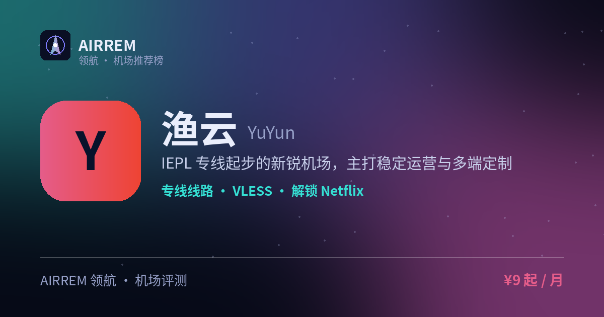

<p align="center"></p>

# 渔云机场官网与套餐 2026：专线机场，长期稳定 / Emby 影音

> **渔云** 适合谁？要 IEPL 专线，还想套餐白送 Emby 影视库。IEPL 专线起步的新锐机场，主打稳定运营与多端定制，全套餐赠送 Emby 影视库，追剧观影一步到位。

<p align="center">
<a href="https://t.rtxk.us/t/txppfd7"></a>
<a href="https://air-rem.github.io/yuyun/"></a>
</p>

👉 **[渔云 官网注册入口](https://t.rtxk.us/t/txppfd7)** ｜ [完整评测与横向对比](https://air-rem.github.io/yuyun/)

---

## 我们的结论

节点覆盖主流地区、协议较新，定位长期稳定而非低价冲量，且各档套餐均赠送 Emby 影视库——装上 Emby 客户端登录即看，稳定、速度快，UP 主在用；新站建议先月付小额验证再长期用。


## 基本信息

| 项目 | 内容 |
| --- | --- |
| 机场名称 | 渔云（CloudFisher） |
| 成立时间 | 2024 |
| 线路类型 | IEPL 专线 + 中转 |
| 支持协议 | VLESS / Hysteria2 |
| 流媒体解锁 | Netflix / Disney+ / ChatGPT / Emby 影视库 |
| 节点地区 | 香港 · 日本 · 台湾 · 新加坡 · 美国 等 |
| 计费方式 | 包月 / 按量 |
| 起步价格 | ¥9 / 月 |
| 推荐场景 | 要 IEPL 专线，还想套餐白送 Emby 影视库 |
| Emby 影音 | 支持 |


## 渔云 套餐价格

| 套餐 | 价格 | 说明 |
| --- | --- | --- |
| Lite | ¥9 | 120GB/月，赠 Emby |
| Plus | ¥15 | 300GB/月，赠 Emby |
| Max | ¥25 | 500GB/月，赠 Emby |
| Air 年付 | ¥60/年 | 148GB/月 |

> 不同来源价格略有出入（约 ¥9–16/月 120G），以官网为准。


## 渔云是什么

渔云（CloudFisher）2024 年前后上线，采用 IEPL 专线与公网中转结合的方案，提供多端定制客户端，主打长期稳定使用。

## 线路 · 协议 · 解锁

覆盖港日台新美等主流地区；采用较新的 VLESS、Hysteria2，官方称提升跨境访问与流媒体体验，支持 Netflix/Disney+/ChatGPT。

- IEPL 专线 + 中转
- 协议：VLESS / Hysteria2
- 支持多端定制客户端
- 全套餐赠送 Emby 影视库，登录即看片

> 💡 具体测速因时段而异，建议实测。


## 优点与缺点

**✅ 优点**

- IEPL 专线起步，方案较新
- 协议 VLESS/Hy2，兼容性好
- 覆盖主流地区
- 多端定制客户端
- 各档套餐均赠送 Emby 影视库，追剧党友好

**⚠️ 缺点**

- 新站运营时间短，稳定性待观察
- 机场行业存在跑路风险，建议先用月付或小额套餐验证稳定性，别一上来就大额年付。


## 适合谁 / 不适合谁

| 👍 适合 | 👎 不适合 |
| --- | --- |
| 需要多端定制客户端 | 偏好运营多年老牌机场的用户 |
| 偏好较新协议、愿先验证 |  |


## 常见问题

**Q：渔云稳定吗？**

A：定位长期稳定，但作为新站建议先月付实测一段时间。

**Q：支持哪些设备？**

A：提供多端定制客户端，具体以官网说明为准。

**Q：渔云的 Emby 影视库怎么用？**

A：渔云各档套餐均赠送 Emby：下载 Emby 客户端，用机场提供的账号登录即可直接在线看片，无需自己找片源；片源与可用性以官网为准。


## 同类机场推荐

拿不定主意？可以再看看这几家同类型的：

- **[西部数据](https://air-rem.github.io/westdata/)** — 稳定专线党，¥17 起
- **[糖果云](https://air-rem.github.io/candycloud/)** — 影视追剧旗舰，¥18 起
- **[红杏云](https://air-rem.github.io/hongxing/)** — 流媒体 / 大流量性价比，¥20 起

全部 38 家机场的横向对比与选购方法论：**[AIRREM 领航 · 机场大全](https://air-rem.github.io/airports/)**


渔云 再好，也只是让你**连得上**。连上之后要用 Claude / GPT / Gemini，可以看看下面这个：

<p align="center">
<a href="https://i.rtxk.us/i/r37kbkg"></a>
<a href="https://i.rtxk.us/i/r37kbkg"></a>
<a href="https://guide.rtxk.us/tutorial/ai-coding/leonis-ai-cc-switch-guide.html"></a>
</p>

> ### 🦁 Leonis AI 中转站 —— 一个端点，抵达所有模型
>
> 机场解决「**连得上**」，[Leonis AI](https://i.rtxk.us/i/r37kbkg) 解决「**用得顺**」。把 **Claude、GPT、Gemini、Grok、Antigravity 等 6+ 模型** 统一成同一个 API 端点：**不改代码、不换客户端，只替换一行 Base URL**。
>
> - **原生工具直连**：Claude Code、Codex CLI、Cherry Studio、NextChat、OpenAI SDK 官方客户端直接用，不需要额外插件或魔改。
> - **全程流式不缓冲**：长回答边生成边吐字，不会卡到最后一次性蹦出来。
> - **多账号池调度**：后端多号轮询，单号被限流时自动顶上，稳定性更好。
> - **一个密钥全模型**：Claude、GPT、Gemini 共用一把 `sk-` 密钥，省心。
>
> ```bash
> export ANTHROPIC_BASE_URL=https://你的专属端点
> export ANTHROPIC_AUTH_TOKEN=sk-你的密钥
> claude
> ```
>
> OpenAI 兼容客户端填 `https://你的专属端点/v1`；也支持 cc-switch「导入到 CCS」一键导入。
> 邮箱注册几十秒，**注册即送体验额度** → **[免费注册 Leonis AI](https://i.rtxk.us/i/r37kbkg)** ｜ [cc-switch 接入教程](https://guide.rtxk.us/tutorial/ai-coding/leonis-ai-cc-switch-guide.html)

---

<sub>数据更新：2026-07 ｜ 价格、套餐与优惠码以官网实时为准 ｜ 本仓库为第三方评测整理，与 渔云 官方无隶属关系 ｜ 请遵守当地法律法规使用网络服务。</sub>

<sub>关键词：渔云、CloudFisher、IEPL专线、VLESS、Hysteria2、Emby机场、Emby影视库、Emby影音机场、影音机场、追剧机场、机场推荐、机场评测</sub>
